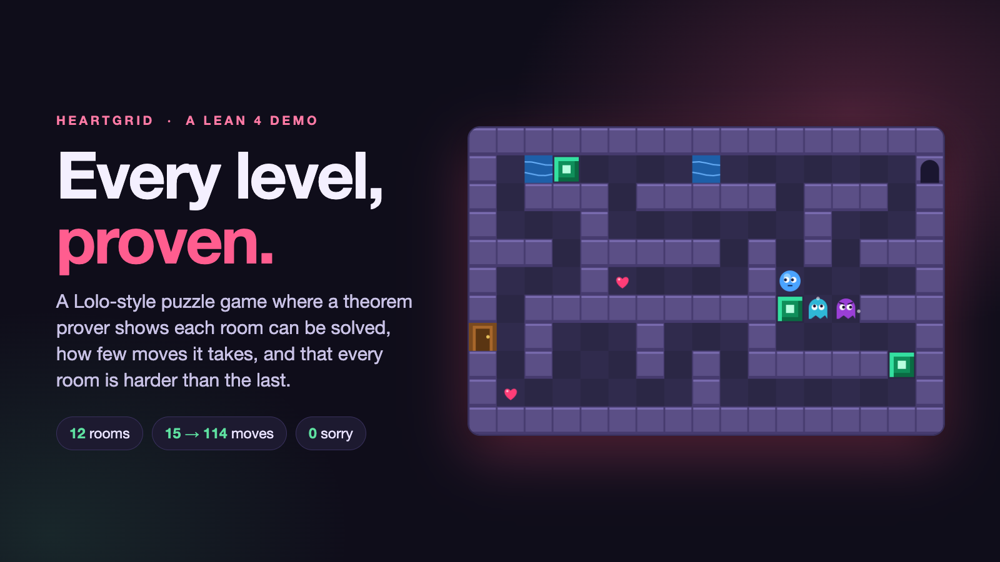
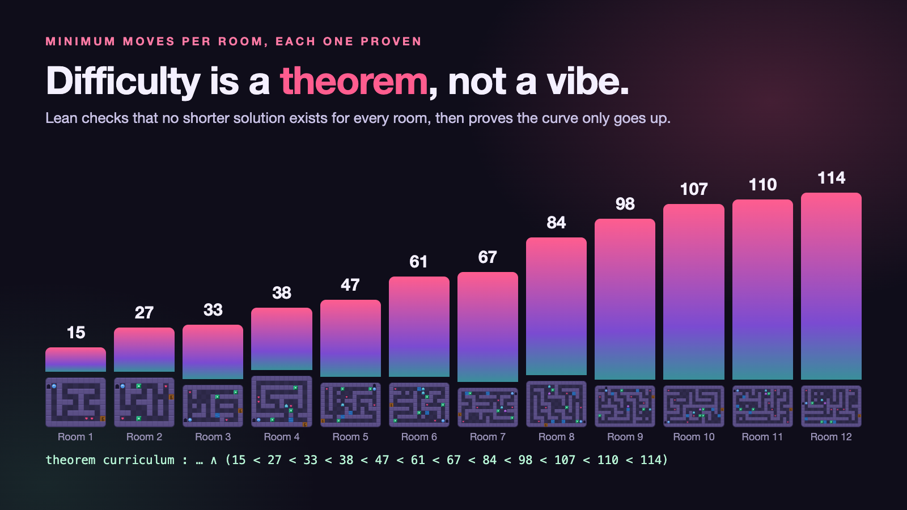
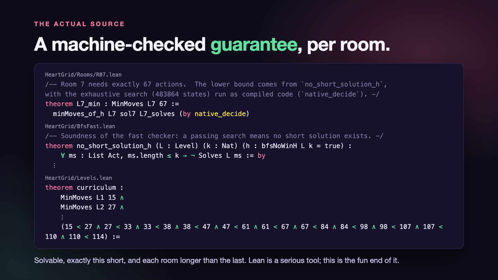

# HeartGrid



A Lolo-style puzzle game where **every room is a theorem**.

Collect every heart, push emerald blocks (into water, to bridge it), dodge patrolling and hunting ghosts,
then leave through the door into the next room. Twelve rooms, each longer to solve than the last, and for
each one Lean 4 proves that it can be solved, that no shorter solution exists, and that each room needs
more moves than the one before: **15 < 27 < 33 < 38 < 47 < 61 < 67 < 84 < 98 < 107 < 110 < 114** moves.

**Play:** https://keithadler.github.io/heartgrid/  ·  or locally with `make play` (then open http://localhost:8755)

| Key | Action |
| --- | --- |
| Arrows / WASD | move (walk into a block to push it) |
| Space | wait one turn (the ghosts still move) |
| Z / R | undo / restart the room |
| G | cycle the coordinate grid: off, label cells, label grid lines (origin (0, 0) bottom-left) |
| *Show shortest solution* | watch the verified shortest solution, with pause and step. Unlocks after you clear the room or try it twice |

Add `?all` to the URL to unlock every room and show every room's shortest length.

**Things to try**
* Guess the move count before you start, then compare your guess, the distance bound, your moves and the shortest possible.
* The side panel shows your cell `(x, y)`, how far you have moved (Δx, Δy), a move log as arrows or as points, and the ratio of shortest to yours as a fraction, decimal and percent.
* *More* has the table of shortest lengths with differences, a plot of them against room number and an optional line of best fit.
* `worksheet.html` prints every room on a labelled grid, with a blank grid and an answer key.

## The rules in one minute
* Walk onto hearts to collect them. The door opens when none are left.
* Push one emerald block at a time. A block pushed into water fills it: both vanish and you can cross.
* **Cyan ghosts** patrol: they walk the way they face and turn round when blocked.
  **Purple ghosts** patrol too, but chase you along a clear row or column once they see you (6 cells).
* Touching a ghost, whoever walks into whom, ends the attempt.
* A move that does nothing (into a wall) is not a turn. Waiting is.
* A purple ghost's line of sight is blocked by walls, emerald blocks and the door only. Water and other ghosts do not block it.

## Why Lean?
Lean is a serious proof assistant, used to verify mathematics and software. This is a deliberately playful
use of it: a game whose *difficulty curve* is a theorem rather than a hunch. Because the rules are written
down precisely in Lean, a claim like "this room needs exactly 61 moves" can be checked by the machine.



## What is proved, and what you are trusting
| Claim | How it is checked |
| --- | --- |
| Each room can be solved (`L*_solves`) | The Lean kernel evaluates the rules along a given move list. Standard axioms only. |
| No shorter solution exists (`L*_min`) | `no_short_solution` is proved once, for **every** room: if a breadth-first search finds no win within *k* moves, none exists. Room 1 runs the search in the kernel; rooms 2-12 run it as compiled code (`native_decide`), which additionally trusts the Lean compiler. |
| Each room needs more moves than the last (`curriculum`) | The twelve minima above, compared by `decide`. Fewest moves is one measure of difficulty, not the only one. |



**The gap:** the game you play is JavaScript, not Lean. `web/engine.js` is a separate implementation of the
rules in `HeartGrid/Rules.lean`. Nothing proves the two identical. They are held together by tests:
every solution is replayed in Lean, in the Python reference (`tools/rules.py`) and in the browser engine,
and `tests/test_cross_engine.py` plays hundreds of random action sequences in both and compares the results.

## Repository layout
```
HeartGrid/Rules.lean       the rules: player, blocks, water, enemies, death
HeartGrid/Bfs.lean         the verified search (kernel-friendly, lists)
HeartGrid/BfsFast.lean     the same search with a hash set, for the big rooms
HeartGrid/Prelude.lean     MinMoves and the two lemmas that turn a search into an optimality proof   (generated)
HeartGrid/Rooms/R*.lean    one file per room: map, solution, proofs                                   (generated)
HeartGrid/Levels.lean      the `curriculum` theorem                                                   (generated)
levels.json                source of truth for all twelve rooms
web/                       the game: engine.js (rules), render.js (drawing), minimap.js, game.js (controller)
tools/                     room generator, C++ solver, Python reference rules, curriculum builder
tests/                     curriculum checks and the Python-vs-browser agreement test
```
Open the project in [Lean Studio](https://github.com/keithadler/leanstudio) or VS Code with the Lean 4
extension; start at `HeartGrid/Rules.lean`.

## Working on it
```bash
make test      # seconds: curriculum data + Python/browser rule agreement
make proofs    # about a minute: checks every Lean proof (needs elan; the toolchain is pinned)
make play      # serve the game
make levels    # regenerate rooms from scratch (slow; replaces levels.json and the generated Lean)
```
Rooms are generated as random corridor mazes, solved exactly by `tools/solve.cpp`, then the generator
writes `levels.json`, the Lean files and `web/levels.js` together so they cannot drift apart.

## Licence
MIT, see `LICENSE`.
